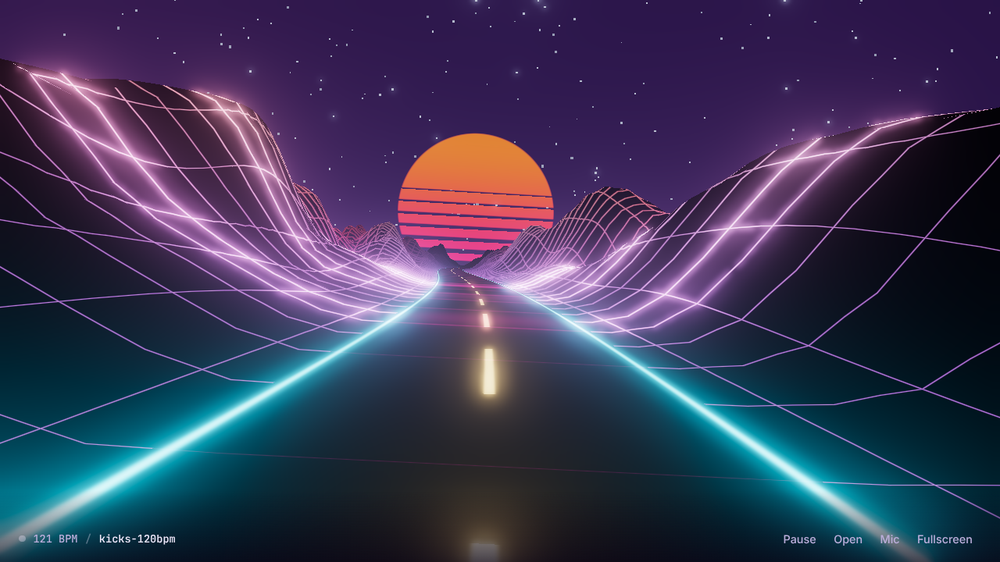
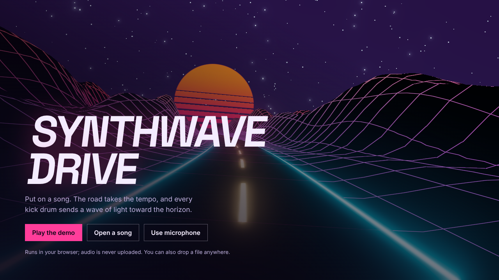
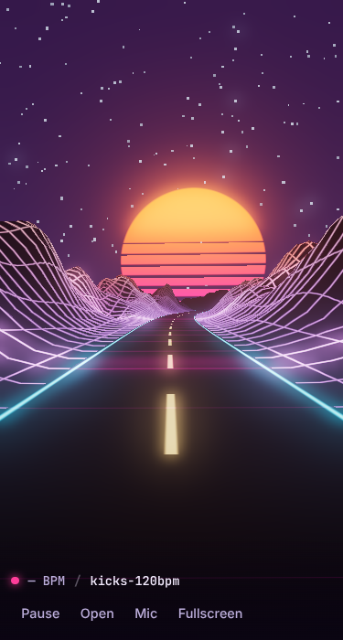

# Synthwave Drive
**Live: https://vincentwesley.github.io/synthwave-drive/**

Put on a song and drive. The road winds toward the sun at the song's tempo, and every kick drum sends a wave of light rolling down it toward the horizon.



| Start | Mobile |
|---|---|
|  |  |

## Use it
Press **Play the demo**, **Open a song** (any audio file) or **Use microphone**, or drop a file anywhere on the page. While driving, **Space** pauses and **F** toggles fullscreen. The controls fade out when the mouse is still.

## How the music drives it
- **Kick drums**: spectral-flux onset detection on the bass band. Each onset launches a light wave from the car to the horizon.
- **Tempo**: the median gap between onsets sets the road speed, so lane dashes pass on the half beat.
- **Energy**: bass lifts the hills, overall loudness adds speed, highs make the stars twinkle.
- **The song as a whole**: an 8-second profile of the spectrum sets the palette and terrain roughness, so every track looks a little different. When a section surges well above its average, the drive goes into overdrive.

## Browser support
Modern Chromium, Firefox and Safari. On iOS, playback with the silent switch on needs iOS 17+. Quality steps down automatically on slow GPUs.

## Develop
```
npm install --ignore-scripts
npm run dev        # dev server
npm run typecheck
npm test
npm run build
npm run e2e        # Playwright + axe
```
Node 24 (`.nvmrc`).

## Deploy
GitHub Pages via `.github/workflows/deploy.yml` on push to `main`. Vite base path is `/synthwave-drive/`.

## Privacy
Audio never leaves your device. No network calls, no analytics, nothing stored. No secrets or env vars needed.

## Licence and credits
MIT, see `LICENSE`. Credits in `CREDITS.md`, third-party licences in `THIRD_PARTY_NOTICES.md`. Creator art is all rights reserved.

Provided as is, no warranty.
